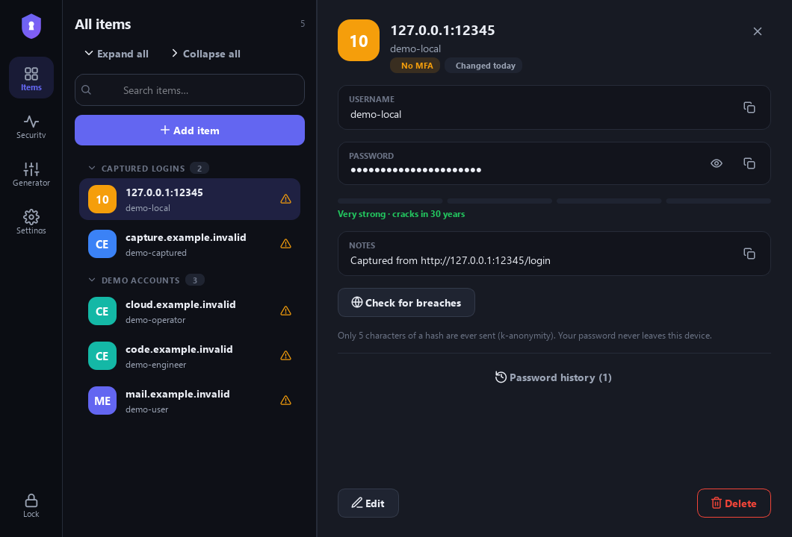
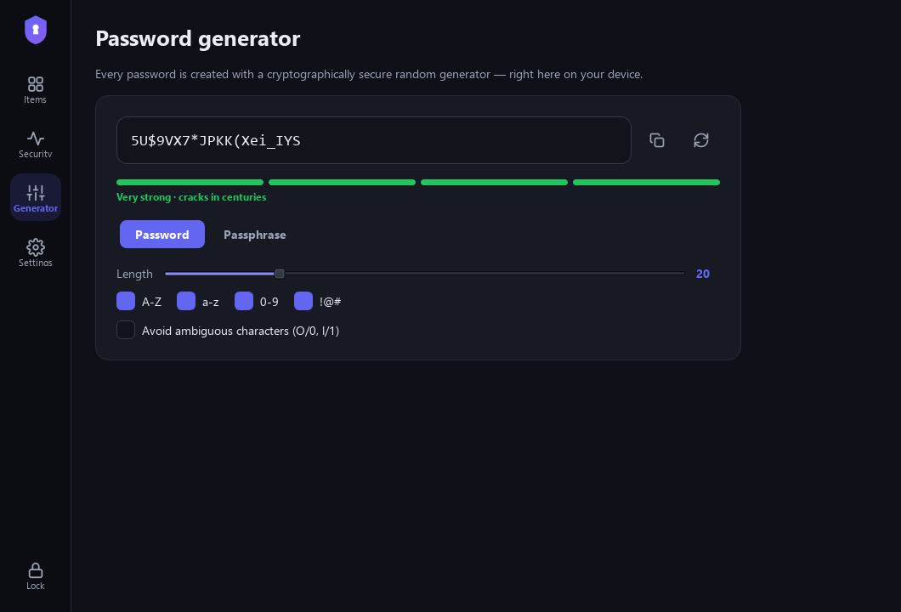

# NoMorePwn

A local desktop password vault with groups, history, and a password generator. Built with Python, PySide6 and SQLite. Offline by design aside from two optional network features (updates and HIBP breach checks).



## Use cases

Organize local credentials into groups, generate passwords, and review credential history in an unlocked desktop vault. The screenshots and tests use fictional accounts in disposable vaults.

Password and note fields use authenticated AES-GCM encryption. Service names, usernames and group metadata remain plaintext in SQLite. Password derivation uses Argon2id, with a PBKDF2 fallback. These implementation choices have not received an independent security audit.

## Releases and install (Windows)

**Download the latest release, [v1.0.27](https://github.com/grloper/NoMorePwn-Password-Manager/releases/tag/v1.0.27):** [Setup.exe](https://github.com/grloper/NoMorePwn-Password-Manager/releases/download/v1.0.27/NoMorePwn-1.0.27-Setup.exe) · [portable.exe](https://github.com/grloper/NoMorePwn-Password-Manager/releases/download/v1.0.27/NoMorePwn-1.0.27-portable.exe) · [SHA256SUMS.txt](https://github.com/grloper/NoMorePwn-Password-Manager/releases/download/v1.0.27/SHA256SUMS.txt)

Windows builds are published on the [Releases page](https://github.com/grloper/NoMorePwn-Password-Manager/releases). Each release has three assets:

- `NoMorePwn-<version>-Setup.exe`: installer (Start-menu shortcut, optional launch at sign-in, uninstaller; no admin rights required).
- `NoMorePwn-<version>-portable.exe`: single-file portable build.
- `SHA256SUMS.txt`: SHA-256 checksums of the two `.exe` files.

**Status: release.** Builds are produced by a manually triggered workflow (which first runs lint and the test suite) Earlier pre-releases were published automatically on every push to `main`. They are not reviewed release candidates, and no independent audit has been done. The in-app updater only follows the release GitHub marks as "Latest", which is a manual promotion step.

**The installers are not code-signed.** Windows SmartScreen will likely warn when you run them. Before running a download, compare its hash with `SHA256SUMS.txt`:

```powershell
Get-FileHash .\NoMorePwn-<version>-Setup.exe -Algorithm SHA256
```

The checksum file is published in the same release as the binaries, so it detects corrupted downloads but does not protect against a compromised GitHub account or release. macOS and Linux have no packaged builds; run from source (below).

See [docs/AUDIT.md](docs/AUDIT.md) for the latest code review (no critical or high issues found; medium gaps listed), [SECURITY.md](SECURITY.md) for reporting vulnerabilities and [docs/THREAT_MODEL.md](docs/THREAT_MODEL.md) for what the app does and does not defend against.

## Run from source

Use Python 3.10+ in a dedicated virtual environment:

```sh
python -m venv .venv
# Activate the environment for your shell.
python -m pip install -r requirements.txt
python -m nomorepwn_app
```

Set `NOMOREPWN_DATA` to a disposable directory before fixture runs. The app includes optional network features such as updates and breach checks; there is no browser extension or native-messaging host.

## Tests

```sh
python -m pip install -r requirements-test.txt
python -m unittest discover -s tests -v
# or: scripts/verify.sh
```

Headless GUI tests use `QT_QPA_PLATFORM=offscreen`.



## Source map

| Area | Source |
|---|---|
| Encryption, database and validation | `nomorepwn/` |
| Desktop views and lifecycle | `nomorepwn_app/` |
| Reproducible fixtures | `tests/` |

Packaged installer behavior, live breach/update providers and independent threat review remain unverified. Python strings can retain copies in memory; this project does not promise complete secret erasure or certified protection.


## License

NoMorePwn is open source under the [MIT License](LICENSE). Copyright (c) 2026 Ofek Ventura.
