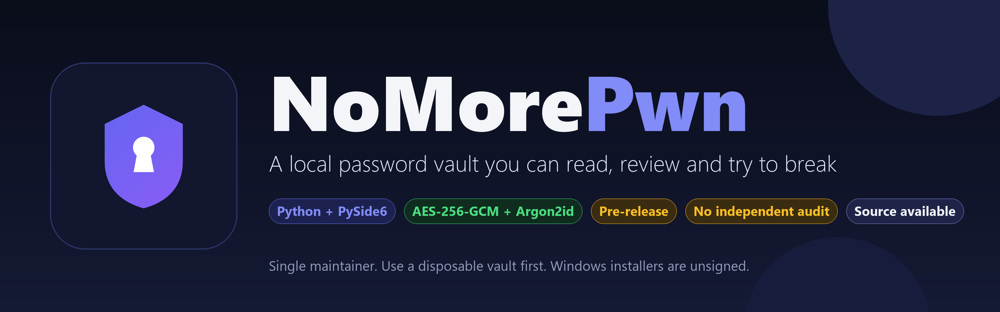
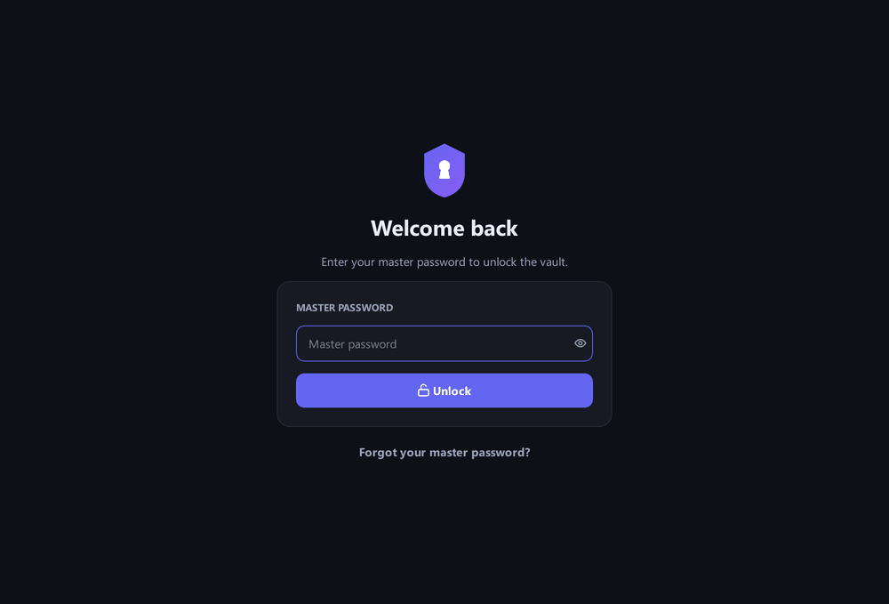
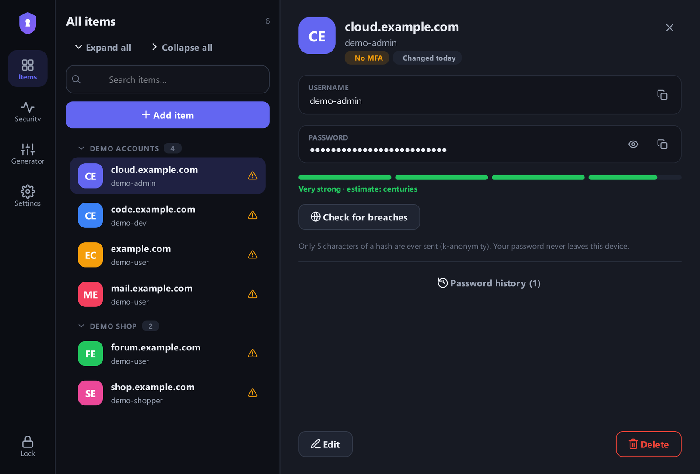
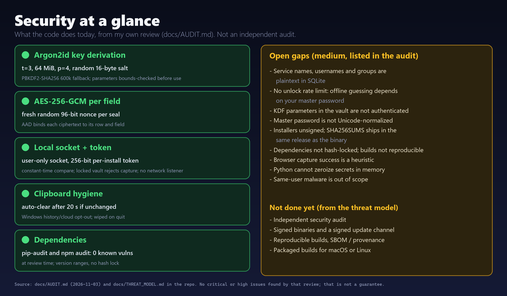
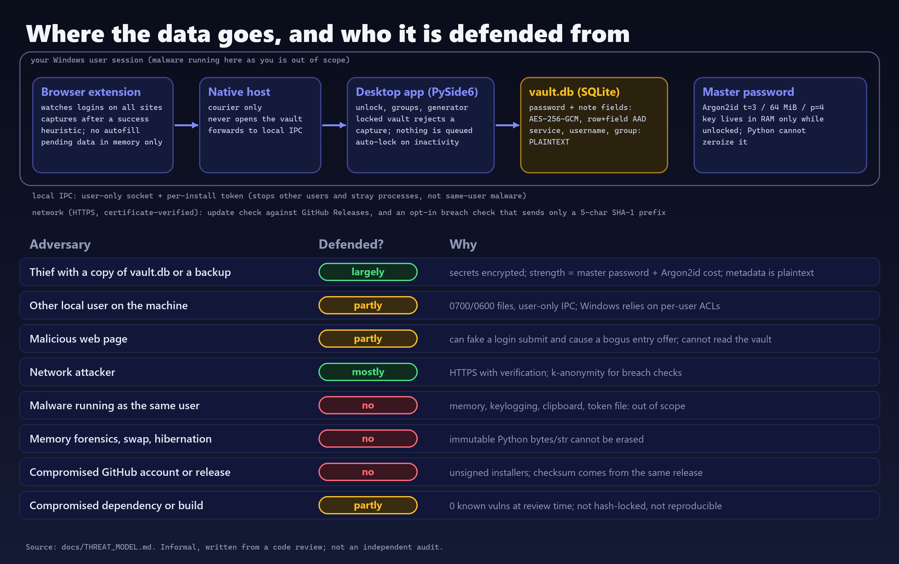
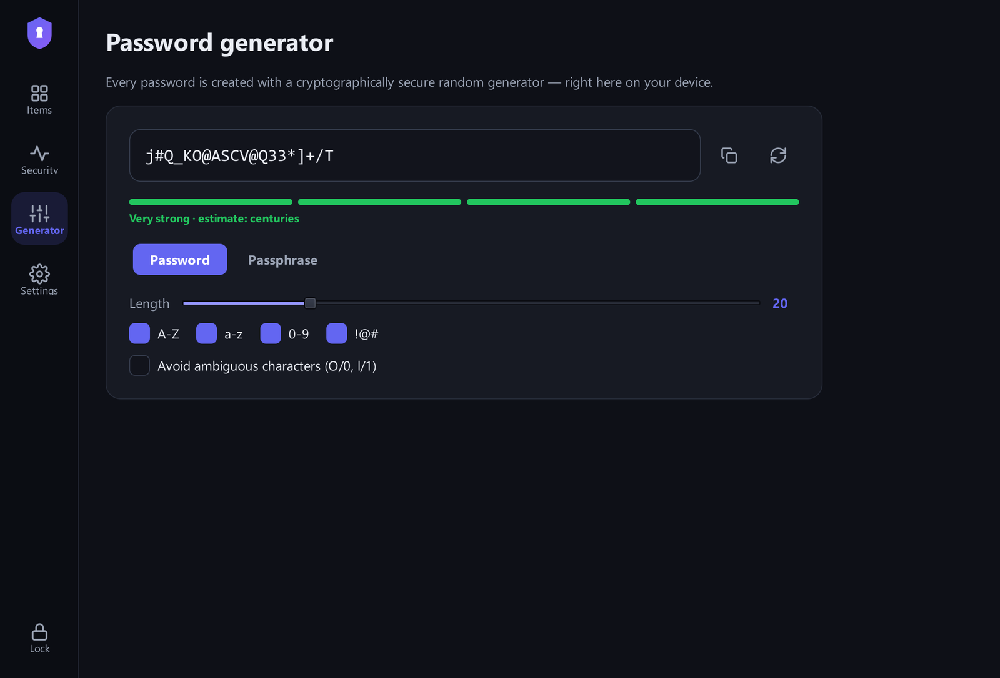

> ⭐ **GitHub: [github.com/grloper/NoMorePwn-Password-Manager](https://github.com/grloper/NoMorePwn-Password-Manager)** · open source (MIT) · by [@grloper](https://github.com/grloper)





I wanted to understand password managers by building one. NoMorePwn is the result: a local desktop vault in Python that I am publishing so people can read it, review it and try to break it. I want to be upfront about what it is. It is a pre-release from one maintainer, it has had no independent security audit, and I do not recommend putting real credentials in it yet. If you are looking for a daily driver, use a mature, audited manager. If you want to read, review or break a small one, this is for you.

One licensing note: the repository is released under the MIT License, so you can read, reuse and modify it under the terms of the LICENSE file.



*A real capture of the app's own UI. I drove the real controller offscreen with a throwaway vault in a temp directory and obviously fake entries (`example.com`, `demo-user`). No real vault or password was used. The "security score" on the dashboard looks like that because every fake account has no MFA flag.*

### What it is

A PySide6 desktop app with a single SQLite vault file. It has groups, credential history, a password generator, a security dashboard, backup and restore, and a Chromium/Firefox extension that captures a login into the unlocked vault. Browser autofill is not implemented, on purpose: capture was the smaller problem to get right first.



### What the cryptography does

I did not write any primitives. The code uses the `cryptography` package's AES-GCM and `argon2-cffi` for key derivation. What I did write is the glue, and the glue is where mistakes live, so here is exactly what it does:

- A master password plus a random 16-byte salt goes through Argon2id (time cost 3, 64 MiB, parallelism 4). If `argon2-cffi` is missing it falls back to PBKDF2-SHA256 with 600,000 iterations. The KDF name and parameters are stored with the vault, and they are bounds-checked before any derivation runs so a hostile vault file cannot make the app burn unbounded memory.
- Password and note fields are sealed with AES-256-GCM, a fresh random 96-bit nonce each time.
- Each ciphertext carries additional authenticated data naming its row and field, so a valid blob copied into another row fails to decrypt.
- The derived key is only in memory while the vault is unlocked.



That card comes from `docs/AUDIT.md`, which is my own review: I read the code, built it from a clean venv, ran the tests and the app. It found no critical or high issues in the vault design and one medium issue that I fixed (copied passwords were eligible for Windows clipboard history and cloud clipboard). It also lists the medium issues that are still open, and they are the part to read carefully:

- Service names, usernames and group names are plaintext in SQLite.
- There is no unlock rate limit, so offline guessing against a stolen vault file depends entirely on your master password (minimum length is 10).
- The KDF parameters stored in the vault are not themselves authenticated. A writer could cause an unlock failure, not a key disclosure.
- The master password is not Unicode-normalized. Normalizing it now would break existing vaults, so I have not changed it.
- Installers are unsigned and dependencies are version ranges, not hash-locked.
- Python keeps secrets in immutable objects, so the app cannot erase them from memory, and nothing here defends against malware running as your user.

### The clipboard

Copied passwords are cleared after 20 seconds, but only if the clipboard still holds the value I copied, so I do not wipe something you copied afterwards. The review found that copies were still eligible for Windows clipboard history and cloud clipboard, so copies now carry the Windows hints that exclude them (best-effort: apps that ignore the hints can still read the clipboard while it holds the value, and other platforms ignore them). A copied secret is also wiped when the app quits.

### The browser extension is the hard part

Capturing a login sounds simple until you ask when a login actually succeeded. The extension watches form submissions and uses same-origin navigation and the final HTTP status as evidence, and cross-origin results go through an unverified confirmation prompt. That is a heuristic, and the docs say so. A page can fake a submit and cause a bogus entry to be offered.

Passwords captured in the browser travel through a native-messaging host to the desktop app over local IPC. The host is only a courier and never opens the vault. If the vault is locked, the capture is rejected and you are asked to unlock and retry, so plaintext passwords are never queued for later. Local IPC messages carry a per-install random 256-bit token, compared in constant time, which stops other users and stray processes but not same-user malware, because that can read the token file.



### How I tested it, and what that does and does not show

For this post I ran the Python suite from a clean checkout of `main`: `python -m unittest discover -s tests` with a temporary `NOMOREPWN_DATA` and the offscreen Qt platform ran 304 tests, all OK, with 11 skipped (Linux or optional dependencies). The browser end-to-end scripts, which drive a real isolated Chromium against local login fixtures, were not re-run for this post, so I am not quoting numbers for them. All fixtures use fictional credentials.

That is component-chain evidence. It is not proof that an installed browser, a registered native host and the packaged app work together on your machine, and the README says that registration of installed browsers, Firefox runtime behaviour and packaged installers remain unverified.

### Releases

Windows builds (installer, portable exe, and a SHA256SUMS file) are published as GitHub pre-releases. They are not code-signed, so SmartScreen will likely warn. The checksum file sits in the same release as the binaries, so it catches a corrupted download but not a compromised release. The in-app updater only follows the release GitHub marks as Latest, checks a checksum, refuses downgrades and asks you first. Code signing and a signed checksum are not done.

### Run it from source

```bash
python -m venv .venv
# activate the environment for your shell
python -m pip install -r requirements.txt
python -m nomorepwn_app
```

Set `NOMOREPWN_DATA` to a disposable directory first, before the process starts. Network features (update check, optional breach check) exist; the breach check sends only a 5-character SHA-1 prefix, and only when you ask for it.



### Why publish something unfinished

Security tools improve under adversarial reading. The repository has a threat model that lists adversaries and says "No" where the answer is no. I would rather have someone find the gap in my reasoning now.

### Try it, and help

Please review `docs/THREAT_MODEL.md` against the code and tell me where they disagree. Report vulnerabilities privately through the Security tab of [github.com/grloper/NoMorePwn-Password-Manager](https://github.com/grloper/NoMorePwn-Password-Manager) (use disposable vaults only, never real data). Good first contributions: signed builds, a macOS or Linux package, and fault-injection tests for backup and restore, which the project's own readiness notes call out.
